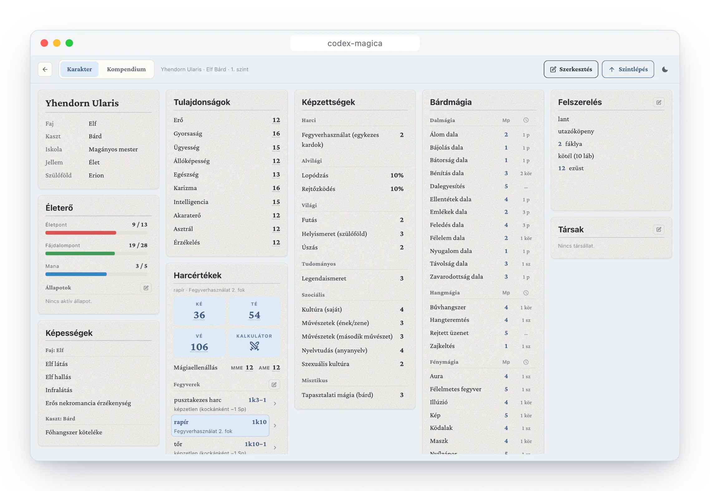
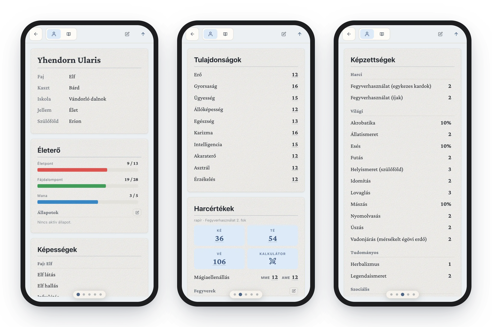

<div align="center">

<picture>
  <source media="(prefers-color-scheme: dark)" srcset="docs/brand/logo-dark.svg">
  
</picture>

# Codex Magica

**Digitális kompendium és karakterlap a _M.A.G.U.S. Új Törvénykönyv_ szabályrendszeréhez.**

Böngészőben fut · telepíthető a kezdőképernyőre · internet nélkül is működik · választható szinkron a saját Google Drive-oddal

[**Az alkalmazás megnyitása**](https://marcigo36.github.io/codex-magica/) · [English](README.md) · **Magyar**

[](https://github.com/marcigo36/codex-magica/actions/workflows/ci.yml)

[](LICENSE)

</div>

<br>

<picture>
  <source media="(prefers-color-scheme: dark)" srcset="docs/assets/hero-dark.webp">
  
</picture>

## Mi ez?

A csapatunk az Új Törvénykönyv szerint játszik, a nyomtatott könyvből és egy gyenge minőségű
szkennelt PDF-ből. Emiatt három dolog volt a kelleténél nehezebb:

- **Játék közben** sokáig tartott kikeresni egy varázslatot vagy szabályt a könyvben vagy a PDF-ben.
- **Két alkalom között** a szintlépés rengeteg adminisztrációval járt: a költségek, előfeltételek és
  bónuszok egy tucat táblázatban voltak szétszórva.
- **A KM-nek** fáradságos volt kézzel, a szabályok szerint megalkotni a mesélői karaktereket.

Ezekre készült ez az alkalmazás:

- 📖 **Kompendium:** az összes képzettség, varázslat, ima, pszi diszciplína, fegyver, vért és méreg
  kereshetően, mindegyik a szabályszövegével, valamint a karakteralkotás táblázatai (tulajdonságok,
  fajok, kasztok, hátterek).
- 🧙 **Karakteralkotó:** faj, kaszt, iskola, hátterek, pontvásárlás, szintenkénti képzettségvásárlás és
  szintlépés. A KAP-költségeket, a tulajdonság-előfeltételeket és a kaszt által adott képzettségeket a
  program számolja. A KM ugyanígy használhatja a mesélői karakterek (NJK-k) elkészítéséhez.
- 📜 **Karakterlap az asztalhoz:** ÉP, FP, Mana, Pszi és Kegy, állapotok, fegyverek, vértek, társállatok.
  Telefonon, iPaden és gépen is jól használható.
- 📱 **Bárhová magaddal viheted:** alkalmazásbolt nélkül telepíthető a kezdőképernyőre, internet nélkül is
  működik, és a saját Google Drive-odon keresztül minden eszközödön ugyanazok a karakterek.

## Amit tud

- **Értékek levezetése:** bármelyik számra (TÉ, VÉ, KÉ, MME…) koppintva látod, mi
  mennyivel járul hozzá: tulajdonságok, HM, fegyver, képzettség, KM-módosítás.
- **Gyorskereső (<kbd>⌘K</kbd>)** az összes varázslatra, képzettségre és tárgyra. Ékezetek nélkül is
  működik: a `tuzgolyo` megtalálja a _Tűzgolyót_.
- **Olvasó nézet:** a mágia- és képzettség-fejezetek táblázat helyett folyó szövegként, a könyv
  sorrendjében is olvashatók, követő tartalomjegyzékkel.
- **Szintenkénti napló:** a karakter döntései szintenként tárolódnak, így bármelyik korábbi szint utólag
  is szerkeszthető.
- **KM-eszközök:** egyedi kaszt, szintenkénti KM-jutalmak és módosítók, egyedi képességek saját
  szabályszöveggel.
- **Házi szabály:** választható átdolgozott képzettségrendszer (karakterenként, a létrehozáskor rögzítve).

## Telefonon, tableten, gépen

<picture>
  <source media="(prefers-color-scheme: dark)" srcset="docs/assets/mobile-dark.webp">
  
</picture>

Telefonon a karakterlap lapozható oldalakra bomlik, iPaden és gépen oszlopokba rendeződik. Van világos és
sötét téma is.

**Alkalmazásként telepíthető.** Alkalmazásbolt nem kell hozzá: nyisd meg az oldalt, és add hozzá a
kezdőképernyőhöz ([így](#hogyan-használhatod)). Ezután teljes képernyőn, saját ikonnal indul, mint
bármelyik másik alkalmazás.

**Internet nélkül is működik.** Az első megnyitáskor az egész alkalmazás az eszközre kerül, a teljes
kompendiummal együtt (kevesebb mint 3 MB). Utána a karakterlap, a karakteralkotó és a kompendium is
működik térerő nélkül, így az sem gond, ha a játék helyszínén nincs internet. Ha új verzió jelenik meg, az
alkalmazás a háttérben letölti, és felajánlja a frissítést. Magától sosem tölt újra, így egy félig kész
karakter sem veszhet el.

**Minden eszközödön ugyanazok a karakterek.** Kapcsold be a karakterlistán a **Google Drive** gombbal a
szinkront, és a karaktereid a telefonodon, a tableteden és a gépeden is ugyanazok lesznek:

- A Drive-odból csak egy rejtett mappához kér hozzáférést, amelyet csak ez az alkalmazás lát. A Drive-od
  többi fájljához nem fér hozzá. Az e-mail-címedet is megkapja, hogy meg tudja mutatni, melyik fiókkal
  szinkronizál.
- A módosítások néhány másodperc múlva szinkronizálódnak, és akkor is, amikor kilépsz az alkalmazásból
  vagy visszatérsz. Ami internet nélkül változott, az a kapcsolat helyreálltakor töltődik fel.
- Ha ugyanazt a karaktert két eszközön is módosítottad, mielőtt szinkronizálódhattak volna, mindkét
  változat megmarad. Semmi sem íródik felül észrevétlenül.
- A webes alkalmazások Google-hozzáférése óránként lejár. Az alkalmazás ezt egy gyors, Google-on keresztüli
  átirányítással megújítja: előtte egy kis értesítést mutat, utána pedig oda hoz vissza, ahol voltál.
- Nem kell fiókot létrehoznod, és nincs köztes szerverünk: az adatok közvetlenül a böngésződből a
  Drive-odra kerülnek. Részletek az [adatvédelmi tájékoztatóban](https://marcigo36.github.io/codex-magica/privacy.html).

**Az adataid nálad maradnak.** Szinkron nélkül a karakterek csak az eszközöd böngészőjében vannak. Az
összes karakterről egy koppintással mentés készíthető, és a fájl egyenesen iCloud Drive-ba, Google
Drive-ba vagy a Fájlokba mehet. Az importálás sosem ír felül semmit, egy-egy karakter pedig exportálható és
elküldhető másnak.

## Hogyan használhatod?

**Megnyitás.** Nyisd meg a **[marcigo36.github.io/codex-magica](https://marcigo36.github.io/codex-magica/)**
oldalt. Bármelyik mai böngészőben fut, és nem kell hozzá regisztrálni.

**Telepítés a kezdőképernyőre.**

| Eszköz | Lépések |
|---|---|
| iPhone, iPad | Safariban: **Megosztás → Főképernyőhöz adás** |
| Android | Chrome-ban: **⋮ → Alkalmazás telepítése** (vagy **Hozzáadás a kezdőképernyőhöz**) |
| Számítógép | Chrome-ban vagy Edge-ben: a címsor jobb végén lévő telepítés ikon; Macen Safariban: **Fájl → Hozzáadás a Dockhoz** |

A telepítés abban is segít, hogy a böngésző tartósan megőrizze az alkalmazás adatait, különösen Safariban.

**Szinkron vagy mentés.** Ha több eszközön is használnád a karaktereidet, koppints a karakterlistán a
**Google Drive** gombra, és kapcsold be a szinkront. Emellett is érdemes időnként megnyomni a **Biztonsági
mentés** gombot: telefonon és tableten a megosztás menü nyílik meg, így a fájl egyenesen iCloud Drive-ba,
Google Drive-ba vagy a Fájlokba mehet. Az **Importálás fájlból** gombbal visszaállítható, akár másik
eszközön is, és sosem ír felül semmit. Egy-egy karaktert ugyanígy elküldhetsz valakinek (karakter menü →
**Exportálás fájlba**).

**Saját példány, ingyen.** Forkold a repót, és a fork **Actions** fülén engedélyezd a workflow-kat. A
fork beállításaiban válaszd a **Pages → Source: GitHub Actions** lehetőséget, vegyél fel egy
`DEPLOY_PAGES` = `true` Actions-változót, majd az Actions fülön futtasd le egyszer a **Deploy to GitHub
Pages** workflow-t. Ezután minden módosítás után magától frissül a
`https://<felhasználóneved>.github.io/codex-magica/` oldal. Saját domainhez a `BASE_PATH` változót is
állítsd `/`-re. (Cloudflare Pages vagy Netlify is jó: build parancs `npm run build`, mappa `dist`.) A
Google Drive-szinkronhoz saját Google OAuth-ügyfélazonosító kell. Ingyenes, és nagyjából negyedóra alatt
beállítható: [docs/google-drive-sync.md](docs/google-drive-sync.md) (angolul). Enélkül a saját példányodban
egyszerűen nincs szinkron gomb, minden más ugyanúgy működik.

**Saját gépen, fejlesztéshez.** [Node.js](https://nodejs.org) 22.12 vagy újabb kell:

```sh
git clone https://github.com/marcigo36/codex-magica.git
cd codex-magica
npm ci
npm run dev          # elérhető: http://localhost:3000
```

A service worker csak az éles buildben aktív (`npm run build && npm run preview`), így a fejlesztői
szerver mindig a friss kódot adja. A Google Drive-szinkron helyi kipróbálásához tedd az
ügyfélazonosítódat a `.env.local` fájlba, `VITE_GOOGLE_CLIENT_ID` néven.

## Hibát találtál?

A szöveg egy rossz minőségű szkennelésből, OCR-rel készült, és bár alaposan át lett olvasva, maradhattak
benne hibák. Ha elírást, hibás táblázatértéket vagy rosszul számolt szabályt találsz, nyiss egy
[issue-t](https://github.com/marcigo36/codex-magica/issues). Írd meg az oldalszámot vagy a fejezetet, és
azt, hogy mi szerepel a könyvben. Pull requestet is szívesen fogadunk.

## Hogyan készült?

Az egész könyv szkennelt oldalakból indult: tesseract OCR (magyar nyelvi modellel) adta a szöveget,
nyelvi modellek a szerkezetet és a táblázatokat, utána pedig rengeteg kézi korrektúra következett. A
részletek angolul, a [fő README-ben](README.md#how-it-was-built) és a
[folyamat leírásában](docs/pdf-pipeline.md) olvashatók.

Az alkalmazásnak nincs saját szervere. A szabályokat egy tisztán számoló motor alkalmazza a karakter
szintenkénti döntéseire, a karakterek a böngészőben tárolódnak, a szinkron pedig közvetlenül a játékos
Google Drive-jával kommunikál, karakterenkénti háromutas összefésüléssel. Erről is a
[fő README-ben](README.md#3--an-app-without-a-server) lehet bővebben olvasni.

## Köszönet és jogok

A repóban található **forráskód** [MIT licenc](LICENSE) alatt szabadon felhasználható.

A **M.A.G.U.S. tartalom**, valamint a játék nevei és fogalmai **nem** tartoznak e licenc alá, azok a
jogosultak szellemi tulajdonát képezik. Az `src/data/` mappában lévő szabályadatok a szabálykönyvből lettek
átírva és újrarendezve ehhez a projekthez, így **származékos művek**: a képzettségek, varázslatok, imák,
pszi diszciplínák és mágiaiskolák, a fegyverek, vértek, tárgyak, mérgek és harci helyzetek leírásait és
szabályszövegét tartalmazzák, továbbá (az `src/model/` mappában) a fajok és kasztok képességeinek, a
tulajdonságoknak és a harcértékeknek rövid leírását. A könyv többi része, például a bevezető és a
karakteralkotás fejezetének szövege, a kasztfejezetek szövege, a világleírás, az istenek, a bestiárium és a
varázstárgyak, nincs benne.

A Codex Magica független, nem kereskedelmi célú rajongói projekt. Nem hivatalos M.A.G.U.S.-termék: nem a
jogosultak adták ki, és a tartalmáért nem ők felelnek. A könyv eredeti közreműködőinek listája a
[NOTICE.md](NOTICE.md) fájlban található. Ha jogosultként bármit módosíttatnál vagy eltávolíttatnál,
nyiss egy [issue-t](https://github.com/marcigo36/codex-magica/issues).

<div align="center">
<br>
<sub>Egy játékoscsapatnak készült, és mindenkinek szól, aki még mindig Yneven kalandozik. 🎲</sub>
</div>
