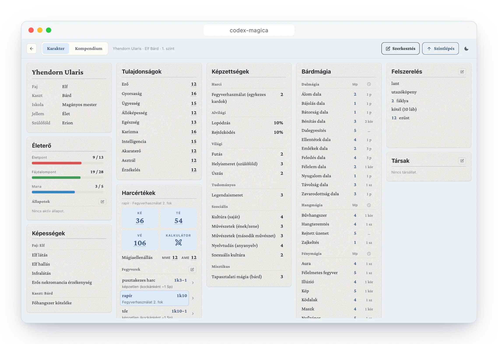
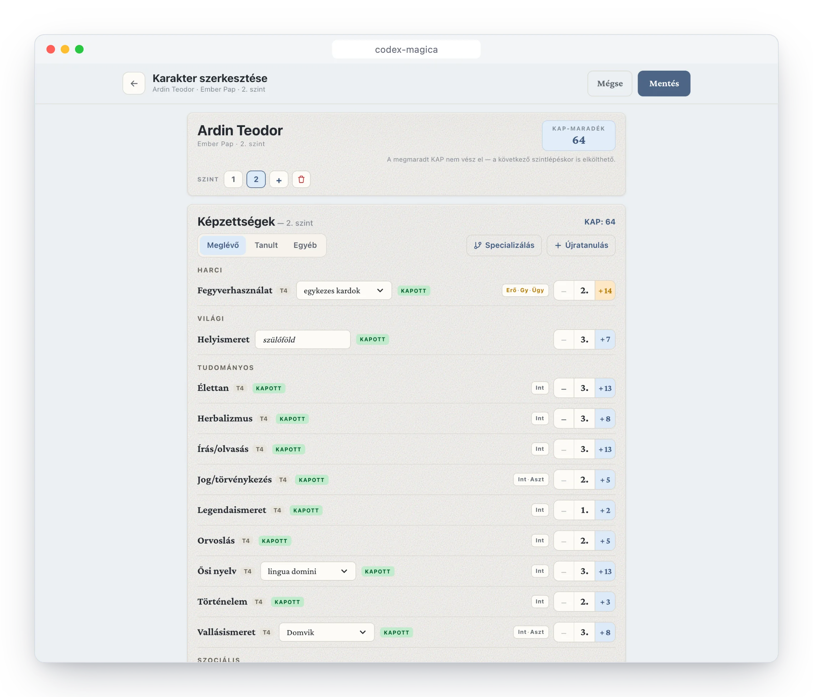
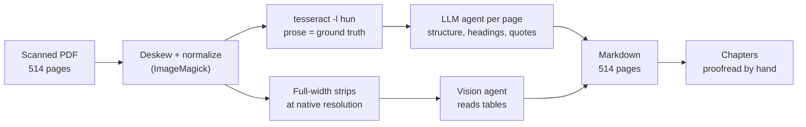
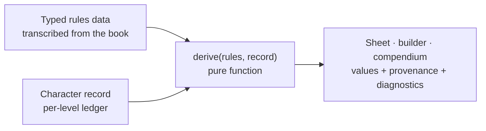

<div align="center">

<picture>
  <source media="(prefers-color-scheme: dark)" srcset="docs/brand/logo-dark.svg">
  
</picture>

# Codex Magica

**A digital compendium and character sheet for _M.A.G.U.S._, the classic Hungarian tabletop RPG,<br>
built from a scanned copy of the _Új Törvénykönyv_ rulebook.**

**English** · [Magyar](README.hu.md)

[](https://github.com/marcigo36/codex-magica/actions/workflows/ci.yml)


[](LICENSE)

</div>

<br>

<picture>
  <source media="(prefers-color-scheme: dark)" srcset="docs/assets/hero-dark.webp">
  
</picture>

## Why this exists

Our group plays _M.A.G.U.S. Új Törvénykönyv_ (2007) from the printed book and a **low-resolution scanned
PDF**. That made three things harder than they should be:

- **During sessions**, finding a spell or a rule in the physical book or the PDF took too long.
- **Between sessions**, levelling up meant a lot of bookkeeping: costs, prerequisites and bonuses spread
  across a dozen tables.
- **For the game master**, building NPCs by hand under the same rules was tedious.

Codex Magica turns the book into:

- 📖 **A searchable compendium**: every skill, spell, prayer, psi discipline, weapon, armor and poison, each with its rules text.
- 🧙 **A guided character builder**: race, class, school, backgrounds, point-buy, per-level skill purchases and level-ups, with the book's costs and prerequisites enforced. It works just as well for the game master's NPCs as for player characters.
- 📜 **A live character sheet for the table**: hit points and pain points, mana, conditions, weapons and armor, companions. It works on a phone, an iPad or a desktop.

It covers 12 classes, 6 races, 83 skills, 636 spells, prayers and psi disciplines, 83 weapons and 21 armors
and shields. The UI is in Hungarian, like the game.

## Features

<table>
<tr>
<td width="50%" valign="top">
<picture>
  <source media="(prefers-color-scheme: dark)" srcset="docs/assets/breakdown-dark.webp">
  
</picture>

**Value breakdowns.** Tap any value on the sheet to see exactly where it comes from: the
attributes, the class, the weapon, the skill level, the game master's adjustments.
</td>
<td width="50%" valign="top">
<picture>
  <source media="(prefers-color-scheme: dark)" srcset="docs/assets/spell-dark.webp">
  
</picture>

**Spells, prayers and psi.** Bard, witch, warlock, fire and high magic, prayers and psi, each
with costs, casting times and durations, and each one's full description one click away.
</td>
</tr>
<tr>
<td width="50%" valign="top">
<picture>
  <source media="(prefers-color-scheme: dark)" srcset="docs/assets/search-dark.webp">
  
</picture>

**Search.** A <kbd>⌘K</kbd> palette searches every spell, skill and item, and you
don't need to type the accents: `tuzgolyo` finds _Tűzgolyó_.
</td>
<td width="50%" valign="top">
<picture>
  <source media="(prefers-color-scheme: dark)" srcset="docs/assets/reader-dark.webp">
  
</picture>

**Reader view.** The magic and skill sections can switch from tables to one continuous text in the
book's order, with a table of contents that tracks your scroll position.
</td>
</tr>
</table>

<picture>
  <source media="(prefers-color-scheme: dark)" srcset="docs/assets/creator-dark.webp">
  
</picture>

**Character builder.** Skills granted by your class are marked, costs and attribute
requirements are computed as you go, and the remaining development points (KAP) carry over to the next
level. Each level is stored as its own entry, so you can go back and edit an earlier one.

**For the game master.** The same builder makes NPCs. On top of it: custom classes, per-level GM grants
and modifiers, custom abilities with their own rules text, and an optional house-rule variant of the
skill system, fixed per character.

<picture>
  <source media="(prefers-color-scheme: dark)" srcset="docs/assets/mobile-dark.webp">
  
</picture>

**Phone, tablet and desktop, online or not.** On a phone the sheet becomes swipeable pages; on an iPad or
desktop it spreads into columns. It installs to the home screen and works offline at the table. Light and
dark themes; characters stay on the device, with one-tap backups.

## How it was built

### 1 · From a scanned PDF to Markdown

The source was a 514-page scan at ~150 DPI with two columns, ornamental borders, rotated margin labels and
dense stat tables. I tried several approaches before settling on a hybrid pipeline (the scripts are in
[`source_material/build/`](source_material/build)):



**Lessons from the pipeline:**

- **Full-page vision transcription hallucinates.** Vision models downscale the image (to a 1568 px long edge for Claude), so dense
  prose blurs and the model fills in plausible but invented words and stat values. Tesseract with the
  Hungarian model is near-perfect on the prose and never invents anything; when unsure it produces
  obvious garbage instead. So **tesseract owns the wording**, and the LLM only decides structure.
- **Tables needed a different approach.** Tesseract destroys table layout, and vision misreads cells on
  full pages. Slicing pages into full-width strips at native resolution (under the downscale limit)
  got the numbers right.
- **Model choice is a cost lever.** A small model grounded in the OCR text handled the prose, and a larger
  model was used only for table strips.
- After assembly came a long round of **proofreading and cross-checking the data against the book**.

The generated Markdown (the full rulebook text) is **not** part of this repository; the scripts are, so
the pipeline can be run on your own copy. The [pipeline write-up](docs/pdf-pipeline.md) covers this in more
detail.

### 2 · From text to a rules engine



- **A character is a ledger, not a stat block.** The record stores decisions: race, class, point-buy,
  and per level the skill purchases, combat-value points and resource buys. `derive()` replays the
  ledger into a full sheet every time, so editing a past level or levelling up is just another replay.
- **The engine is a pure, total function.** It never throws. Bad input shows up as diagnostics the builder can show.
  Derived values carry their **provenance** (which attribute, class, item or adjustment contributed what), and that powers the "explain this number" modals.
- **Golden snapshot tests pin the rules.** Representative characters (a barbarian warrior, a Domvik
  priest, a Doran wizard, an elf bard) are derived in full and snapshotted, so a refactor that changes a
  number fails CI. A `validateRules` test checks that the rules data is internally consistent.
- **House rules as data variants.** Each character is fixed to a rules variant at creation; the
  homebrew skill rework is a transform over the base rules, not a fork of the code.
- **Local-first.** There's no backend and no account. Characters live in `localStorage`, schema
  migrations run on load so old saves keep working, and a character can be exported to and imported from
  a JSON file.

### 3 · Hosting

The app is a static, offline-capable build (a service worker precaches everything), so it can be hosted
anywhere; see [Use it](#use-it). The setup that ran our group's private instance
is kept as a documented example in [`examples/aws-infra/`](examples/aws-infra): S3 + CloudFront, a
Lambda@Edge function that only lets in allowlisted Google accounts (verified Firebase ID tokens), a
standalone login page, and a CodePipeline that deploys on every push. All of it is Terraform.

## Use it

**Host your own copy (free, a few clicks).**

- **GitHub Pages:** fork this repository and enable workflows in the fork's **Actions** tab. In its
  settings choose **Pages → Source: GitHub Actions** and add the Actions variable `DEPLOY_PAGES` = `true`,
  then run **Deploy to GitHub Pages** once from the Actions tab. After that every push to `main` deploys to
  `https://<you>.github.io/codex-magica/` ([workflow](.github/workflows/deploy.yml)). For a custom domain,
  also set the variable `BASE_PATH` = `/`.
- **Cloudflare Pages, Netlify, or any static host** (these also work with private repositories): build
  command `npm run build`, output folder `dist`.

**Install it.** Open the site, then on iPad/iPhone use Safari's **Share → Add to Home Screen**, on Android
Chrome's **Install app**. It then opens like an app and works without a connection. When a new version is
deployed, the app offers to update; it never reloads on its own.

**Keep your characters safe.** There's no account and no server: characters live in the browser on your
device. Use **Biztonsági mentés** (backup) on the roster now and then; on a phone or tablet it opens the
share sheet, so the file can go straight to iCloud Drive, Google Drive or Files. **Importálás fájlból**
restores it, on the same or another device, and never overwrites anything. Single characters can be sent
to someone else the same way (character menu → **Exportálás fájlba**). The app also asks the browser to
keep its storage permanently; installing it to the home screen helps with that on Safari.

## Found a mistake?

The text comes from OCR of a low-quality scan and was proofread by hand, but errors can remain. If you spot
a typo, a wrong table value or a rule the app calculates differently from the book, please
[open an issue](https://github.com/marcigo36/codex-magica/issues) with the page or chapter and what the
book says. Pull requests are welcome too.

## Getting started (development)

Requires Node.js 22.12 or newer.

```sh
git clone https://github.com/marcigo36/codex-magica.git
cd codex-magica
npm ci
npm run dev          # http://localhost:3000
```

| Command | What it does |
|---|---|
| `npm test` | Vitest suite, including the rules-engine golden snapshots |
| `npm run typecheck` | Type check with TypeScript 7 |
| `npm run lint` | Oxlint, including the React hooks rules |
| `npm run build` | Production build into `dist/` (`npm run preview` serves it) |

The service worker is only active in production builds (`npm run build && npm run preview`), so the dev
server always serves fresh code.

<details>
<summary><b>Project structure</b></summary>

```text
src/
├── engine/          derive(): the pure rules engine, in phases, with golden tests
├── model/           rules model: classes, races, skills, effects DSL, house-rule variants
├── data/            typed rules data transcribed from the book (spells, weapons, armor…)
├── book/            not distributed: optional local copy of two rulebook chapters
├── state/           roster storage (localStorage), migrations, import/export
├── ui/              React + Chakra UI screens: welcome, sheet, builder, compendium
└── fonts/           Crimson Pro (OFL)
source_material/
└── build/           the PDF → Markdown pipeline: scripts and agent instructions
examples/aws-infra/  example hosting: Terraform, Lambda@Edge Google sign-in gate, login page
docs/                design notes, pipeline write-up, README assets
```

</details>

## Tech stack

**App:** React 19 · TypeScript 7 · Chakra UI 2 · Emotion · Vite 8 · vite-plugin-pwa (Workbox)<br>
**Storage:** localStorage · JSON import/export<br>
**Pipeline:** tesseract (`hun`) · ImageMagick · LLM agents (Claude Haiku for prose, Sonnet for tables)<br>
**Tooling:** Vitest · Oxlint · GitHub Actions<br>
**Example hosting:** Terraform · AWS S3 · CloudFront · Lambda@Edge · CodePipeline / CodeBuild · Firebase Auth

## Credits & license

The **code** in this repository is open source under the [MIT License](LICENSE).

The **M.A.G.U.S. content** is **not** covered by that license and remains the property of its respective
rights holders, as do the game's names and terms. The rules data in `src/data/` was transcribed and
restructured from the rulebook for this project, so it is a **derivative work**. It contains
the descriptions and rules text of skills, spells, prayers, psi disciplines and the magic schools,
weapons, armor, items, poisons and combat situations, plus short descriptions of class and race
abilities, attributes and combat values (in `src/model/`). The rest of the book, including the
introduction and character-creation chapters, the class chapters' prose, the world and lore, the gods,
the bestiary and the magic items, is not included.

Codex Magica is an independent, non-commercial fan project and not an official M.A.G.U.S. product: it is
not published or endorsed by the rights holders, who are not responsible for its content. The book's original
credits are reproduced in [NOTICE.md](NOTICE.md). If you hold rights to this material and would like
something changed or removed, please [open an issue](https://github.com/marcigo36/codex-magica/issues).

The interface font is [Crimson Pro](https://github.com/Fonthausen/CrimsonPro) (SIL OFL 1.1). The icons are
from [Lucide](https://lucide.dev) and [Tabler](https://tabler.io/icons).

<div align="center">
<br>
<sub>Made for one gaming group, shared with everyone who still plays on Ynev. 🎲</sub>
</div>
