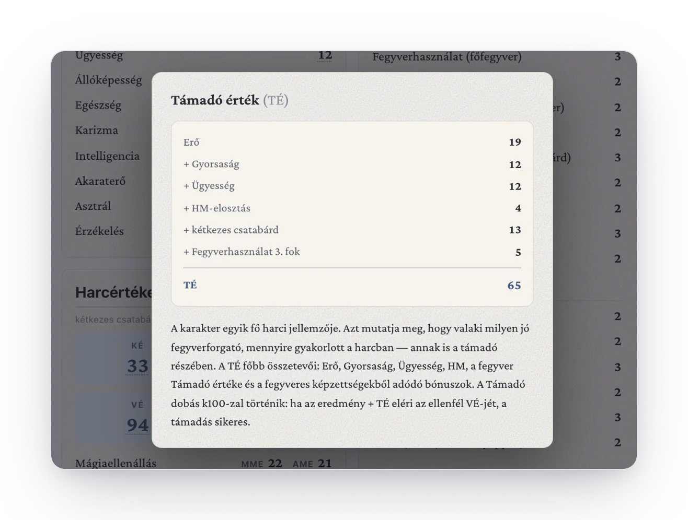
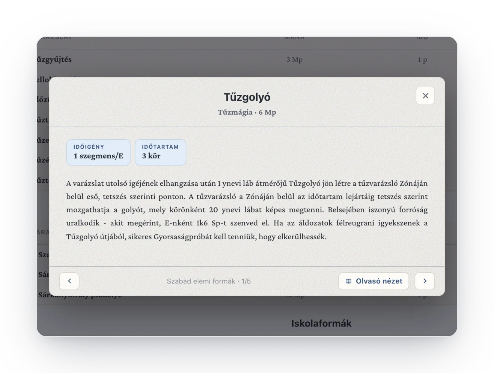
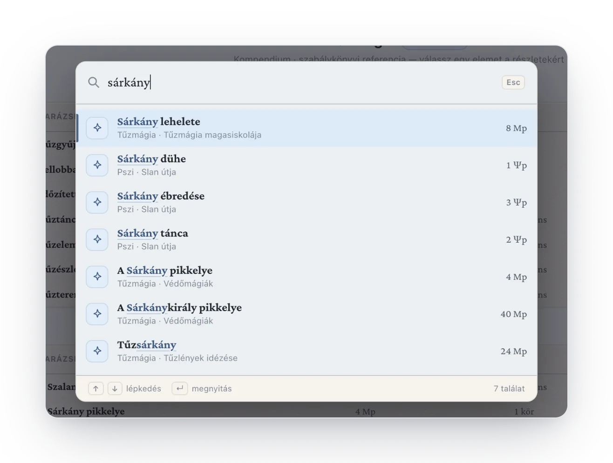
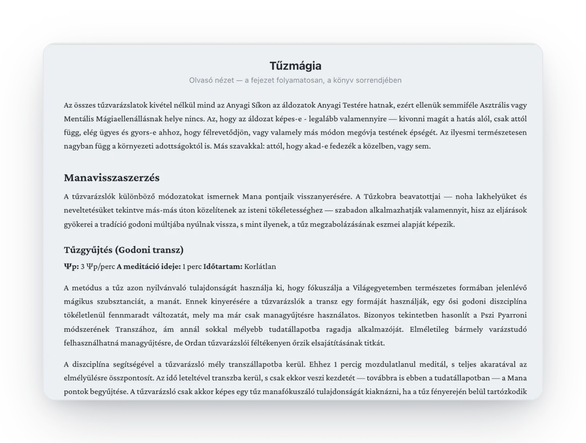
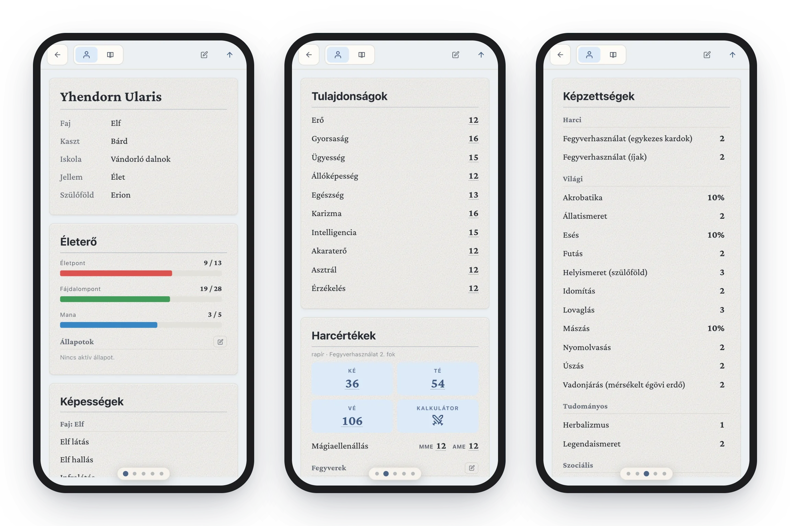
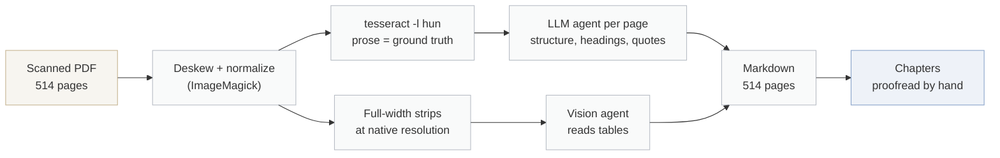
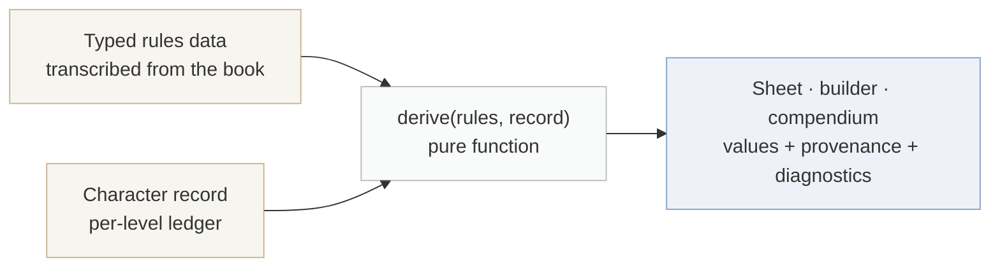
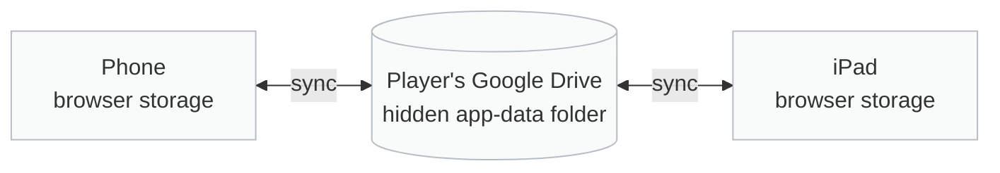

<div align="center">

<picture>
  <source media="(prefers-color-scheme: dark)" srcset="docs/brand/logo-dark.svg">
  
</picture>

# Codex Magica

**A digital compendium and character sheet for _M.A.G.U.S._, the classic Hungarian tabletop RPG,<br>
built from a scanned copy of the _Új Törvénykönyv_ rulebook.**

Runs in the browser · installs to the home screen · works offline · optional sync through your own Google Drive

[**Open the app**](https://codex-magica.github.io/) · **English** · [Magyar](README.hu.md)

[Features](#features) · [Install it](#use-it) · [How it was built](#how-it-was-built)

[](https://github.com/codex-magica/codex-magica.github.io/actions/workflows/ci.yml)


[](LICENSE)

</div>

<br>

<picture>
  <source media="(prefers-color-scheme: dark)" srcset="docs/assets/hero-dark.webp">
  
</picture>

## Why this exists

Our group plays _M.A.G.U.S. Új Törvénykönyv_ (2007) from the printed book and a **low-resolution scanned
PDF**. That made three things harder than they should be:

- **During sessions**, finding a spell or a rule in the physical book or the PDF took too long.
- **Between sessions**, levelling up meant a lot of bookkeeping: costs, prerequisites and bonuses spread
  across a dozen tables.
- **For the game master**, building NPCs by hand under the same rules was tedious.

Codex Magica turns the book into:

- 📖 **A searchable compendium**: every skill, spell, prayer, psi discipline, weapon, armor and poison, each with its rules text, plus character-creation tables for attributes, races, classes and backgrounds.
- 🧙 **A guided character builder**: race, class, school, backgrounds, point-buy, per-level skill purchases and level-ups, with the book's costs and prerequisites enforced. It works just as well for the game master's NPCs as for player characters.
- 📜 **A live character sheet for the table**: hit points and pain points, mana, conditions, weapons and armor, companions. It works on a phone, an iPad or a desktop.
- 📱 **An app you can take anywhere**: it installs to the home screen without an app store, works offline, and can keep your characters in sync across devices through your own Google Drive.

It covers 12 classes, 6 races, 83 skills, 636 spells, prayers and psi disciplines, 83 weapons and 21 armors
and shields. The UI is in Hungarian, like the game.

### Under the hood, in short

- **A 514-page scanned rulebook turned into data** by an OCR + LLM pipeline, then proofread by hand
  ([how](#1--from-a-scanned-pdf-to-markdown)).
- **A pure rules engine:** every value on the sheet is recomputed from the character's per-level decisions,
  with its provenance, and golden snapshot tests pin the rules ([how](#2--from-text-to-a-rules-engine)).
- **Local-first sync with no backend of my own:** each device writes its own file to the player's Google
  Drive; version vectors tell replaced from parallel edits, a conflict asks the player which version to
  keep, and randomized multi-device tests check that nothing is lost ([how](#3--an-app-without-a-server)).
- **A stateless token service** on Cloudflare's free plan keeps Google's permission renewed without
  storing anything.
- **250+ tests**, type-checked and linted in CI.

## Features

<table>
<tr>
<td width="50%" valign="top">
<picture>
  <source media="(prefers-color-scheme: dark)" srcset="docs/assets/breakdown-dark.webp">
  
</picture>

**Value breakdowns.** Tap any value on the sheet to see exactly where it comes from: the
attributes, the class, the weapon, the skill level, the game master's adjustments.
</td>
<td width="50%" valign="top">
<picture>
  <source media="(prefers-color-scheme: dark)" srcset="docs/assets/spell-dark.webp">
  
</picture>

**Spells, prayers and psi.** Bard, witch, warlock, fire and high magic, prayers and psi, each
with costs, casting times and durations, and each one's full description one click away.
</td>
</tr>
<tr>
<td width="50%" valign="top">
<picture>
  <source media="(prefers-color-scheme: dark)" srcset="docs/assets/search-dark.webp">
  
</picture>

**Search.** A <kbd>⌘K</kbd> / <kbd>Ctrl K</kbd> palette searches every spell, skill and item, and you
don't need to type the accents: `tuzgolyo` finds _Tűzgolyó_.
</td>
<td width="50%" valign="top">
<picture>
  <source media="(prefers-color-scheme: dark)" srcset="docs/assets/reader-dark.webp">
  
</picture>

**Reader view.** The magic and skill sections can switch from tables to one continuous text in the
book's order, with a table of contents that tracks your scroll position.
</td>
</tr>
</table>

<picture>
  <source media="(prefers-color-scheme: dark)" srcset="docs/assets/creator-dark.webp">
  
</picture>

**Character builder.** Skills granted by your class are marked, costs and attribute
requirements are computed as you go, and the remaining development points (KAP) carry over to the next
level. Each level is stored as its own entry, so you can go back and edit an earlier one.

**For the game master.** The same builder makes NPCs. On top of it: custom classes, per-level GM grants
and modifiers, custom abilities with their own rules text, and an optional house-rule variant of the
skill system, fixed per character.

## At the table, on any device

<picture>
  <source media="(prefers-color-scheme: dark)" srcset="docs/assets/mobile-dark.webp">
  
</picture>

On a phone the sheet becomes swipeable pages; on an iPad or a desktop it spreads into columns. It's dark by
default, with a light theme a tap away.

**Install it like an app.** There's no app store involved: open the site and add it to your home screen
([how](#use-it)). It then starts full screen with its own icon, like any other app.

**Works offline.** The first visit stores the whole app on the device, the complete compendium included
(under 3 MB). After that the sheet, the builder and the compendium all work without a connection, so a
game room with no signal is fine. When a new version is published, the app downloads it in the background
and offers to switch. It never reloads by itself, so a half-built character can't be lost.

**Your characters on every device.** Turn on **Google Drive** on the roster, and your characters stay the
same on your phone, tablet and computer:

- The only Drive access the app asks for is a hidden folder that only this app can see. It can't see any
  of your other files.
- Changes sync a few seconds after you make them, when you leave the app and when you come back. Changes
  made offline go up once you're back online.
- If the same character was edited on two devices before they could sync, the app asks which version to
  keep (or keeps both). Nothing is overwritten silently.
- With daily backups on (the default), the last state of each day a character was edited, and its last
  state before deletion, stay in your Drive too, and can be restored from the sync window.
- There's no account to create, and your characters go straight from your browser to your Drive.

**Your data stays with you.** Without sync, characters live only in the browser on your device. A backup
of all of them is one tap away, and the file can go straight to iCloud Drive, Google Drive or Files.
Importing never overwrites anything, and single characters can be exported to share with someone.

## How it was built

### 1 · From a scanned PDF to Markdown

The source was a 514-page scan at ~150 DPI with two columns, ornamental borders, rotated margin labels and
dense stat tables. I tried several approaches before settling on a hybrid pipeline (the scripts are in
[`source_material/build/`](source_material/build)):



**Lessons from the pipeline:**

- **Full-page vision transcription hallucinates.** Vision models downscale the image (to a 1568 px long edge for Claude), so dense
  prose blurs and the model fills in plausible but invented words and stat values. Tesseract with the
  Hungarian model is near-perfect on the prose and never invents anything; when unsure it produces
  obvious garbage instead. So **tesseract owns the wording**, and the LLM only decides structure.
- **Tables needed a different approach.** Tesseract destroys table layout, and vision misreads cells on
  full pages. Slicing pages into full-width strips at native resolution (under the downscale limit)
  got the numbers right.
- **Model choice is a cost lever.** A small model grounded in the OCR text handled the prose, and a larger
  model was used only for table strips.
- After assembly came a long round of **proofreading and cross-checking the data against the book**.

The generated Markdown (the full rulebook text) is **not** part of this repository; the scripts are, so
the pipeline can be run on your own copy. The [pipeline write-up](docs/pdf-pipeline.md) covers this in more
detail.

### 2 · From text to a rules engine



- **A character is a ledger, not a stat block.** The record stores decisions: race, class, point-buy,
  and per level the skill purchases, combat-value points and resource buys. `derive()` replays the
  ledger into a full sheet every time, so editing a past level or levelling up is just another replay.
- **The engine is a pure function.** Rule problems in a build (a missing prerequisite, an overspent level)
  come back as diagnostics the builder can show, not as errors. Derived values carry their **provenance** (which attribute, class, item or adjustment contributed what), and that powers the "explain this number" modals.
- **Golden snapshot tests pin the rules.** Representative characters (a barbarian warrior, a Domvik
  priest, a Doran wizard, an elf bard) are derived in full and snapshotted, so a refactor that changes a
  number fails CI. A `validateRules` test checks that the rules data is internally consistent.
- **House rules as data variants.** Each character is fixed to a rules variant at creation; the
  homebrew skill rework is a transform over the base rules, not a fork of the code.

### 3 · An app without a server



- **Local-first.** There's no backend and no account. Characters live in `localStorage`, schema
  migrations run on load so old saves keep working, the app asks the browser for persistent storage, and
  characters can be exported to and imported from JSON files.
- **Installable and offline.** `vite-plugin-pwa` (Workbox) precaches the whole build, and the rules data
  is bundled with the code, so nothing needs the network after the first load. Updates are offered, never
  forced. An installed app can stay open for days, so it checks for a new version every hour.
- **Sync without a backend.** The browser talks to the Google Drive REST API directly. Each device writes
  only its own JSON file in the player's app-data folder and reads the others', so two devices can never
  overwrite each other (Drive has no conditional writes). Every character carries a version vector, so
  "replaced" and "edited in parallel" are told apart without trusting device clocks: an edit beats a
  parallel deletion, and for parallel edits the player is asked which version to keep; the other one is
  stored alongside until then, identically on every device. A failed or
  damaged download never leads to an overwrite, and optional daily backups keep each day's last state and
  the last state before a deletion. Randomized tests run several devices with concurrent rounds, failing
  requests and skewed clocks, and check that they converge and lose nothing.
- **Hourly tokens without hourly taps.** Browser apps get one-hour Google access tokens, and the long-term
  refresh token needs a client secret, which a public web app can't keep. A stateless Cloudflare Worker
  (`worker/`, free plan) holds the secret: it turns the consent page's one-time code into an access token
  plus the refresh token encrypted into an opaque credential, which stays on the device, and later turns that
  credential into fresh access tokens. It stores nothing, logs nothing, answers only the app's origins, and
  never sees Drive data. Setup, details and the
  options weighed: [docs/google-drive-sync.md](docs/google-drive-sync.md).

### 4 · How I worked

I built this with AI coding assistants (Claude). I set the direction, the architecture and the game's
rules, checked the data against the book, and reviewed the changes; the commits made together with an
assistant are marked as co-authored. The PDF pipeline above also uses LLMs, as described there.

### 5 · Hosting

The app is a static, offline-capable build (a service worker precaches everything), so any static host
works. This repository deploys itself to GitHub Pages with a GitHub Actions workflow, and a fork can do the
same in a few clicks; see [Use it](#use-it).

## Use it

**Open it.** Go to **[codex-magica.github.io](https://codex-magica.github.io/)**. It
runs in any current browser (iPhone and iPad: iOS 15.4 or later), and there's nothing to sign up for.

**Add it to your home screen.**

| Device | How |
|---|---|
| iPhone, iPad | in Safari: **Share → Add to Home Screen** |
| Android | in Chrome: **⋮ → Install app** (or **Add to Home screen**) |
| Computer | in Chrome or Edge: the install icon at the right end of the address bar; in Safari on a Mac: **File → Add to Dock** |

Installing also makes the browser more likely to keep the app's storage for good, Safari especially.

**Sync or back up.** To use your characters on more than one device, tap **Google Drive** on the roster
and turn it on. Either way, tap **Exportálás** (export) now and then. On a phone or tablet it opens
the share sheet, so the file can go straight to iCloud Drive, Google Drive or Files. **Importálás**
(import) restores it on the same or another device, and never overwrites anything. Single characters can
be sent to someone the same way: character menu → **Exportálás fájlba** (export).

**Host your own copy (free, a few clicks).**

- **GitHub Pages:** fork this repository (name the fork `codex-magica`) and enable workflows in the fork's **Actions** tab. In its
  settings choose **Pages → Source: GitHub Actions** and add the Actions variable `DEPLOY_PAGES` = `true`,
  then run **Deploy to GitHub Pages** once from the Actions tab. After that every push to `main` deploys to
  `https://<you>.github.io/codex-magica/` ([workflow](.github/workflows/deploy.yml)). For a custom domain,
  also set the variables `BASE_PATH` = `/` and `SITE_URL` = your address (for link previews).
- **Cloudflare Pages, Netlify, or any static host** (these also work with private repositories): build
  command `npm run build`, output folder `dist`.
- **Google Drive sync** needs a Google OAuth client ID of your own and the token service in `worker/`,
  deployed to Cloudflare's free plan. Both are free and take about half an hour:
  [docs/google-drive-sync.md](docs/google-drive-sync.md). Without them, your copy simply has no sync
  button, and everything else works the same.

## Found a mistake?

The text comes from OCR of a low-resolution scan and was proofread by hand, but errors can remain. If you spot
a typo, a wrong table value or a rule the app calculates differently from the book, please
[open an issue](https://github.com/codex-magica/codex-magica.github.io/issues/new/choose) (there's a form for it) with the
page or chapter and what the book says. Pull requests are welcome too.

## Getting started (development)

Requires Node.js 22.12 or newer.

```sh
git clone https://github.com/codex-magica/codex-magica.github.io.git codex-magica
cd codex-magica
npm ci
npm run dev          # http://localhost:3000
```

| Command | What it does |
|---|---|
| `npm test` | Vitest suite, including the rules-engine golden snapshots |
| `npm run typecheck` | Type check with TypeScript 7 |
| `npm run lint` | Oxlint, including the React hooks rules |
| `npm run build` | Production build into `dist/` (`npm run preview` serves it) |

The service worker is only active in production builds (`npm run build && npm run preview`), so the dev
server always serves fresh code. To try Google Drive sync locally, put your client ID in `.env.local` as
`VITE_GOOGLE_CLIENT_ID` ([setup](docs/google-drive-sync.md)).

<details>
<summary><b>Project structure</b></summary>

```text
src/
├── engine/          derive(): the pure rules engine, in phases, with golden tests
├── model/           rules model: classes, races, skills, effects DSL, house-rule variants
├── data/            typed rules data transcribed from the book (spells, weapons, armor…)
├── book/            not distributed: local output of the PDF pipeline (the app does not read it)
├── state/           roster storage (localStorage), migrations, import/export, Google Drive sync
├── ui/              React + Chakra UI screens: welcome, sheet, builder, compendium
└── fonts/           Crimson Pro, plus a few symbols from EB Garamond (OFL)
source_material/
└── build/           the PDF → Markdown pipeline: scripts and agent instructions
docs/                Drive sync and PDF pipeline write-ups, icon sources, README screenshots
```

</details>

## Tech stack

**App:** React 19 · TypeScript 7 · Chakra UI 2 · Emotion · Vite 8 · vite-plugin-pwa (Workbox)<br>
**Storage:** localStorage · JSON import/export · optional Google Drive sync (Google Identity Services, Drive REST API, app-data folder)<br>
**Pipeline:** tesseract (`hun`) · ImageMagick · LLM agents (Claude Haiku for prose, Sonnet for tables)<br>
**Tooling:** Vitest · Oxlint · GitHub Actions

## Credits & license

The **code** in this repository is open source under the [MIT License](LICENSE).

The [privacy notice](https://codex-magica.github.io/privacy.html) describes what the optional Google Drive
sync does with your data.

The **M.A.G.U.S. content** is **not** covered by that license and remains the property of its respective
rights holders, as do the game's names and terms. The rules data in `src/data/` was transcribed and
restructured from the rulebook for this project, so it is a **derivative work**. It contains
the descriptions and rules text of skills, spells, prayers, psi disciplines and the magic schools,
weapons, armor, items, poisons and combat situations, plus short descriptions of class and race
abilities, attributes and combat values (in `src/model/`). The rest of the book, including the text of
the introduction and character-creation chapters, the class chapters' prose, the world and lore, the gods,
the bestiary and the magic items, is not included.

Codex Magica is an independent, non-commercial fan project and not an official M.A.G.U.S. product: it is
not published or endorsed by the rights holders, who are not responsible for its content. The book's original
credits are reproduced in [NOTICE.md](NOTICE.md). If you hold rights to this material and would like
something changed or removed, please [open an issue](https://github.com/codex-magica/codex-magica.github.io/issues).

The interface font is [Crimson Pro](https://github.com/Fonthausen/CrimsonPro), with Ψ and ⅓ from [EB Garamond](https://github.com/octaviopardo/EBGaramond12) (both SIL OFL 1.1). Some icons are
from [Lucide](https://lucide.dev) and [Tabler](https://tabler.io/icons); their license texts are in [THIRD_PARTY_LICENSES.md](THIRD_PARTY_LICENSES.md).

<div align="center">
<br>
<sub>Made by <a href="https://github.com/marcigo36">Márton Dániel</a>, originally for personal use, and shared with everyone who adventures on Ynev. 🎲</sub>
</div>
