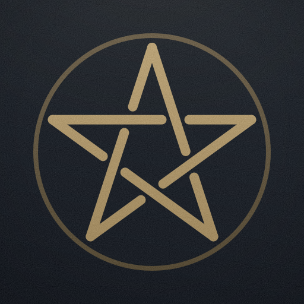
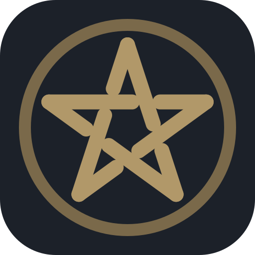

# Codex Magica icon

<p align="center">
  &nbsp;&nbsp;&nbsp;
  
</p>

## Idea

A **pentagram drawn as a woven knot**, inside a faint ring. Travelling along the star, each line
passes *over* the first line it crosses and *under* the next, the way interlace is drawn in illuminated
manuscripts and on old seals. The pentagram is the classic emblem of magic in fantasy role-playing; the
weave turns it from a stock symbol into a crafted mark, a little like a page ornament in a codex.

## Construction

All values are on a 512 × 512 canvas, centred at 256, 256 (see [`build_icons.py`](build_icons.py)).

| Part | Value |
|---|---|
| Star | points on radius 176, five straight strands 16 wide with round ends |
| Weave | each strand passes under at 61.8% of its length; the gap there is 16 + 30 = 46 long |
| Ring | radius 196, stroke 8 |
| Favicon | heavier for tiny sizes: points on radius 166, strands 30; ring radius 206, stroke 24, a shade lighter |
| Finish | a faint version of the app panels' parchment surface on the tile (see below) |

Every line of a pentagram crosses the others at the **golden-ratio points** of its length, 38.2% and
61.8%. So the weave is exact and needs no path maths: a strand is drawn in two pieces, with a gap
around its 61.8% crossing. Going round the star, that gives over, under, over, under: a true
alternating knot.

## Colours

Taken from the app's dark theme, so the icon looks at home next to the UI. The tile is the colour of the
character cards, the gold is a muted version of the app's Kegy gold, and the ring is a dark, gold-tinted
line like the cards' warm borders. Values were chosen in OKLCH.

| Name | Hex | OKLCH | Use |
|---|---|---|---|
| Card | `#1c2129` | 0.247 0.016 258 | tile background (the app's `sheet` colour) |
| Antique gold | `#b19869` | 0.69 0.07 82 | strands on dark |
| Ring gold | `#60533c` | 0.45 0.04 82 | ring on dark |
| Favicon ring | `#7a694a` | 0.53 0.05 82 | a little lighter, so the ring survives in a 16 px tab |
| Deep antique gold | `#8d6f3a` | 0.56 0.08 80 | strands on white |
| Pale ring | `#d1c2a7` | 0.82 0.04 82 | ring on white (lighter than the strands, mirroring the dark version) |
| Dev red | `#d64545` | | DEV badge on development icons |

## Finish

The tiles carry the panels' parchment surface at well below the panels' strength, so the icon is a little
less flat without looking textured:

- the tile: 3.5% lighter at the top, 11% deeper at the bottom, at the panels' 158° angle;
- a warm glow from the top edge (`#c9ad7c` at 5%) and a slight falloff toward the corners (14% black);
- gilt: strands 9% lighter at the top point and 9% deeper at the lower points, the ring 8% / 10%;
- paper grain over all of it: fractal noise added as an even brightness jitter (about ±1.5% per pixel),
  so it doesn't lighten or grey the colours the way a soft-light blend would.

The DEV badges sit on top of the finish, crisp. The README logos stay flat.

## Files

| Master | Rendered to | Notes |
|---|---|---|
| `icon.svg` | `public/logo192.png`, `public/logo512.png` | Full-bleed square: iOS and Android apply their own rounded mask. Also the apple-touch icon. |
| `icon-maskable.svg` | `public/logo512-maskable.png` | Scaled to 92% so everything sits inside Android's 80% safe zone |
| `icon-dev.svg` | `public/logo192-dev.png`, `public/logo512-dev.png` | DEV badge below the star, used by the dev server so a home-screen install is distinguishable |
| `favicon.svg` | `public/favicon.svg`, `public/favicon.ico` (16, 32, 48) | heavier strands and a stronger ring, so both survive in a browser tab |
| `favicon-dev.svg` | `public/favicon-dev.svg`, `public/favicon-dev.ico` | red dot instead of the pill |
| `logo-light.svg`, `logo-dark.svg` | used directly by the READMEs | transparent; the weave's gaps need no background colour, so it sits on any page |

## Regenerating

Render every master at **512 and scale down** from there: rendering straight at 16 or 192 px samples the
grain too coarsely and it comes out harsh. Any SVG renderer with filter support works (the shipped
files were rendered in Chrome); for example with librsvg and ImageMagick:

```sh
python3 docs/brand/build_icons.py                    # writes the SVG masters here

cd docs/brand
for f in icon icon-dev icon-maskable favicon favicon-dev; do rsvg-convert -w 512 $f.svg -o /tmp/$f.png; done
P=../../public
magick /tmp/icon.png $P/logo512.png;          magick /tmp/icon.png -resize 192x192 $P/logo192.png
magick /tmp/icon-dev.png $P/logo512-dev.png;  magick /tmp/icon-dev.png -resize 192x192 $P/logo192-dev.png
magick /tmp/icon-maskable.png $P/logo512-maskable.png
for d in "" -dev; do
  for s in 16 32 48; do magick /tmp/favicon$d.png -resize ${s}x$s /tmp/f$d$s.png; done
  magick /tmp/f${d}16.png /tmp/f${d}32.png /tmp/f${d}48.png $P/favicon$d.ico
done
cp favicon.svg favicon-dev.svg $P/
# the grain doesn't compress: a 256-colour palette keeps it visually identical (~52 dB) at half the size
for f in $P/logo*.png; do magick $f -dither None -colors 256 PNG8:$f; done
```

Then bump the `?v=` on the icon links in `index.html`, so Safari doesn't keep the old ones.

## Using it

- Use the full icon from 64 px up; below that, use the heavier favicon version.
- Keep one point of the star up.
- On white use `logo-light.svg`; on dark use `logo-dark.svg` or the icon.
- Leave clear space around the logo of at least a tenth of its width.

## How it came about

The app first used the M.A.G.U.S. sigil scanned from the rulebook. Replacing it, we explored several
directions:
- the sigil's structure with the app's own symbols in place of its runes;
- astral stars, a radiant book, a grimoire cover, a wax seal, a constellation, a quill nib and a bookmark;
- a dozen variations of the woven knot.

This one won for keeping the pentagram while making it unmistakably its own drawing. To iterate further,
start from this file and `build_icons.py`: the construction table above is the brief.
