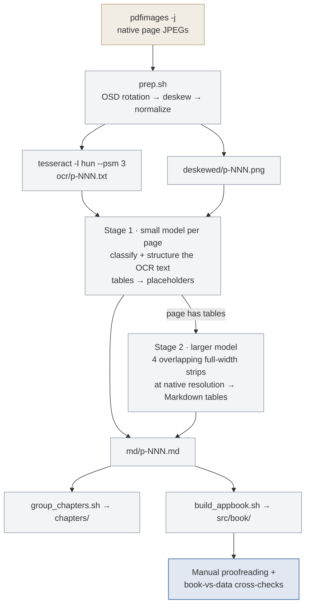

# From a scanned rulebook to Markdown

This is how the 514-page scanned _M.A.G.U.S. Új Törvénykönyv_ became Markdown, and from there the
typed data in `src/data/`. The scripts referenced here are in
[`source_material/build/`](../source_material/build). The scanned PDF, the intermediate images, the OCR
text and the generated Markdown (the full rulebook text) are **not** in the repo.

## The input

- 514 pages, one JPEG per page at ~150 DPI.
- Two-column layout, ornamental page frames, chapter labels rotated in the margins.
- Italic flavour text, sidebars, full-page illustrations, and many **dense stat tables** where one wrong
  digit (`2k6+2` vs `4k6+2`) means a wrong rule.
- Some pages scanned rotated 90°/180°, some faint and low-contrast.

## What didn't work

| Approach | Result |
|---|---|
| **Full-page vision transcription** | Fluent, confident, and **wrong**. Vision models downscale the image (to a 1568 px long edge for Claude), so dense 150 DPI prose blurs and the model invents plausible words and stat values. One made-up term ("Lingofunk") and several wrong weapon damage values showed up in the first pilot pages. |
| **Plain tesseract for everything** | Near-perfect prose, but tables came out as scrambled text with the columns lost. |
| **Fixed-rectangle crops for tables** | Per-page skew moved the tables, so fixed crops cut through rows. |

## What worked: let each tool do what it's good at

1. **Prep** ([`prep.sh`](../source_material/build/prep.sh)): tesseract's orientation detection rotates
   pages upright, ImageMagick deskews and normalizes them, and `tesseract -l hun` produces the prose. The
   script can resume and keeps going past a bad page.
2. **Stage 1, page assembly** ([`AGENT_INSTRUCTIONS.md`](../source_material/build/AGENT_INSTRUCTIONS.md)):
   one agent per page takes **the words from tesseract, never from the image**. It uses the image only for
   things OCR can't see: reading order across columns, headings, italic flavour passages, frame junk to
   drop, and where the tables are. Each page is classified as `ART_ONLY`, `TOC`, `PROSE`, `TABLE`, `FAINT`
   or `BLANK` against a JSON schema.
3. **Stage 2, tables** ([`assemble.workflow.js`](../source_material/build/assemble.workflow.js),
   [`tablefill.workflow.js`](../source_material/build/tablefill.workflow.js)): pages with tables are cut
   into four overlapping full-width bands. Each band stays under the downscale limit, so the model reads
   the table at full resolution. It then replaces the placeholders, removes rows duplicated by the overlap,
   and marks anything illegible as `[?]` instead of guessing.
4. **Assembly** ([`group_chapters.sh`](../source_material/build/group_chapters.sh),
   [`build_appbook.sh`](../source_material/build/build_appbook.sh)): pages are joined into chapters, front
   and back matter are dropped, duplicate headings are merged, and page breaks are fixed.
5. **Proofreading.** The longest part. The Markdown was read against the scan, then the typed rules data
   (`src/data/`, `src/model/`) was cross-checked against the book.

## Running it

The shell scripts (`prep.sh`, `group_chapters.sh`, `build_appbook.sh`) need only tesseract (with the `hun`
language data) and ImageMagick. The two `*.workflow.js` files are Claude Code workflow scripts: they use
its `agent()`, `pipeline()` and `phase()` helpers to fan the pages out to sub-agents, so they run inside
Claude Code rather than plain Node. `AGENT_INSTRUCTIONS.md` is the per-page brief each agent receives.

## Practical lessons

- **Use OCR for the words and the LLM for the structure.** An LLM grounded in OCR text restructures
  reliably and doesn't hallucinate; an LLM reading pixels it can't resolve does.
- **Know your model's input resolution.** Most of the quality came from keeping images under the
  downscale limit, not from a bigger model.
- **Pick models per stage.** The small model did the bulk prose work; the larger one was reserved for the
  few dozen table pages. Set the model explicitly on every agent, because the default can inherit the
  most expensive one.
- **Never start a stage on incomplete input.** Agents given pages that hadn't been prepped yet
  confidently classified them as `BLANK`.
- **Don't trust an agent's self-diagnosis** ("this page is rotated 180°"). Check against the pixels.
- **Make it resumable.** Every stage skips finished pages, so an interrupted run costs nothing.
