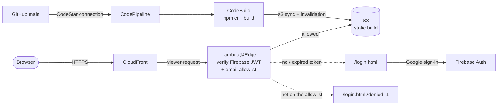
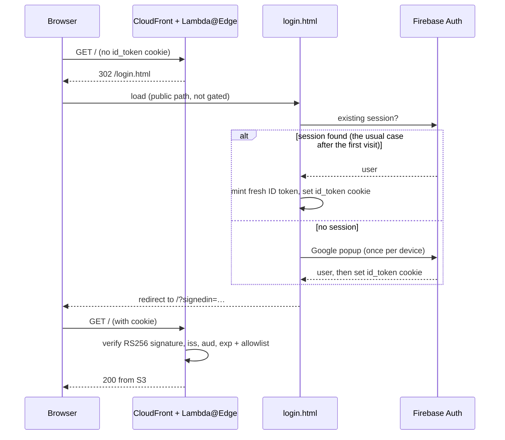

# Example: private hosting behind Google sign-in (AWS + Firebase)

> **This is an example, not part of the app.** Codex Magica itself is a static, local-only web app:
> `npm start` / `npm run build` need none of this. This folder is the setup that once hosted a private
> instance for our gaming group, kept as a reference for anyone who wants to put a static single-page app
> behind a **Google sign-in with an email allowlist, without running a backend**.

## What it does

- Serves the production build from a **private S3 bucket through CloudFront**.
- Runs a small **Lambda@Edge** function on every request that checks for a valid **Firebase ID token** in a
  cookie, and lets the request through only if the token's email is on an **allowlist**.
- Redirects everyone else to a standalone, branded **login page** (`login.html`) that signs in with Google
  via Firebase Auth, sets the cookie and sends the user back.
- Rebuilds and redeploys on every push to `main` with **CodePipeline + CodeBuild**.
- Everything is **Terraform**; the allowlist and account-specific settings live in gitignored files.

## Architecture



## How the sign-in works



Details that make it pleasant to use:

- **Silent renewal.** Firebase ID tokens last about an hour. When one expires, the edge sends the user to
  `login.html`, which finds the persisted Firebase session, mints a fresh token and bounces straight back.
  There's no popup and the user barely sees it.
- **No redirect loops.** A valid token for an email that isn't allowlisted goes to `?denied=1`; the login
  page then signs out, explains, and never auto-redirects. The silent path also stops after three
  automatic redirects in 30 seconds and shows the sign-in button instead.
- **Cache-busting redirects** (`/?signedin=<timestamp>`), so the browser can't serve `/` from its cache and
  skip the edge check.
- **Certificate caching.** The edge function caches Google's public signing certificates for as long as
  their `Cache-Control` header allows.
- **Public paths.** `login.html`, the favicons/logos, the web manifest and `robots.txt` bypass the gate so
  the login page can render.

## Files

| File | What it does |
|---|---|
| `s3.tf` | Private bucket for the build, readable only through CloudFront (Origin Access Control). |
| `cloudfront.tf` | The distribution and the edge function. The allowlist and Firebase project ID are rendered into the function source with `templatefile()`, because Lambda@Edge has no environment variables. |
| `cloudfront_edge.js` | The viewer-request handler: token verification, allowlist check, redirects. |
| `login.html` | The standalone login page (no framework, Firebase loaded from Google's CDN, light and dark theme). The build copies it to the site root. |
| `pipeline.tf`, `buildspec.yaml` | GitHub → CodePipeline → CodeBuild → `s3 sync` + CloudFront invalidation. |
| `backend.tf` | Remote Terraform state in S3 with DynamoDB locking (bucket supplied at init time). |
| `variables.tf`, `locals.tf`, `providers.tf`, `outputs.tf` | Inputs, naming, providers (incl. the `us-east-1` alias Lambda@Edge requires), outputs. |

## Setting it up

1. **Firebase.** Create a project, enable **Authentication → Sign-in method → Google**, and register a web
   app. Put its config into the `firebaseConfig` block in `login.html`. After the first deploy, add your
   CloudFront domain under **Authentication → Settings → Authorized domains**.
2. **GitHub connection.** In the AWS console create a CodeStar (CodeConnections) connection to GitHub named
   after `project_name` (default `codex-magica`) and approve it.
3. **Terraform inputs.** From this folder:

   ```sh
   cp backend.hcl.example backend.hcl            # your state bucket + lock table
   cp terraform.tfvars.example terraform.tfvars  # allowlist, Firebase project ID, GitHub owner…
   terraform init -backend-config=backend.hcl
   terraform apply
   ```

4. **Deploy.** Push to `main`; the pipeline builds the app, copies `login.html` into the build and syncs it
   to S3. The site URL is the `cloudfront_domain` output.

Changing the allowlist means editing `terraform.tfvars` and running `terraform apply` again; a new edge
function version takes a few minutes to reach every CloudFront location.

## Optional: keep the cookie fresh from inside the app

The app in this repository has no login code, so after the hourly token expiry the next full page load
takes the silent trip through `login.html` described above. If you'd rather keep the cookie fresh while
the app is open (and offer a sign-out button), add Firebase to the app and something like:

```ts
import { initializeApp } from "firebase/app";
import { getAuth, onIdTokenChanged, signOut } from "firebase/auth";

const auth = getAuth(initializeApp(firebaseConfig)); // same config as login.html

// Write every token rotation back to the cookie the edge checks.
onIdTokenChanged(auth, async (user) => {
  if (user) document.cookie = `id_token=${await user.getIdToken()}; Path=/; Secure; SameSite=Lax`;
});

// Sign out: end the Firebase session first (or login.html would silently sign you back in),
// then drop the cookie and reload through the gate.
export const logout = async () => {
  await signOut(auth).catch(() => {});
  document.cookie = "id_token=; Path=/; Secure; SameSite=Lax; Max-Age=0";
  window.location.replace(`${window.location.origin}/?loggedout=${Date.now()}`);
};
```

## Caveats

- The gate protects **files**, not data: it's right for a private static app, but anything the app fetches
  from other services needs its own authorization.
- Lambda@Edge functions must live in `us-east-1` and are slow to delete (replicas linger for a while after
  the distribution lets go of them).
- The Firebase web config in `login.html` is public by design; access control is the allowlist in the edge
  function (and, if you use Firestore, its security rules).
