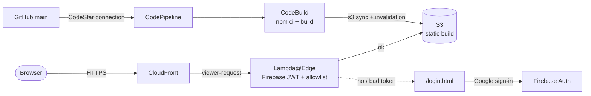

# Infrastructure

> **Status: archived but working.** This is the Terraform that hosted the private instance for our
> gaming group. It is kept here as a reference; you don't need any of it to run the app locally.

The app is a static SPA, so hosting is deliberately boring: an S3 bucket behind CloudFront, with a
Lambda@Edge function acting as the login gate, and a CodePipeline that rebuilds on every push to `main`.



| File | What it does |
|---|---|
| `s3.tf` | Private bucket for the build, readable only through CloudFront (Origin Access Control). |
| `cloudfront.tf` | Distribution + the edge function. The allowlist is rendered into the function source with `templatefile()`, because Lambda@Edge has no environment variables. |
| `cloudfront_edge.js` | Viewer-request handler: verifies the Firebase ID token (RS256 against Google's `securetoken` certs, issuer / audience / expiry), then checks the email against the allowlist. |
| `pipeline.tf` / `buildspec.yaml` | GitHub → CodePipeline → CodeBuild → `s3 sync` + CloudFront invalidation. |
| `backend.tf` | Remote state in S3 with DynamoDB locking (bucket supplied at init time). |

## Deploying your own copy

```sh
cd infrastructure
cp backend.hcl.example backend.hcl            # your state bucket
cp terraform.tfvars.example terraform.tfvars  # your allowlist, profile, GitHub owner
terraform init -backend-config=backend.hcl
terraform apply
```

You'll also need a Firebase project with Google sign-in enabled (its web config lives in
`src/state/firebase.ts` and `public/login.html`) and an AWS CodeStar connection to GitHub named as in
`pipeline.tf`.
